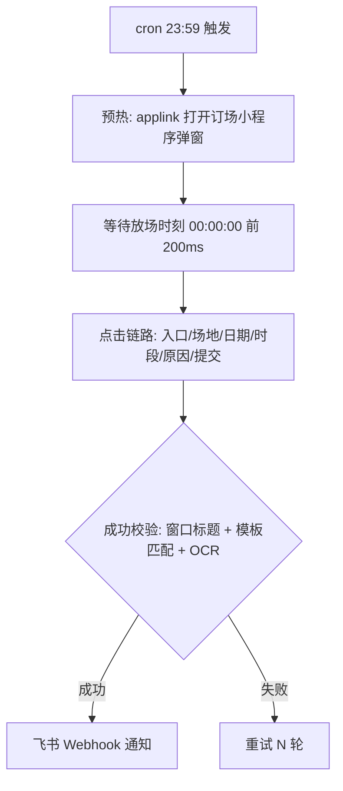

# feishu-venue-grabber

基于飞书（Feishu/Lark）桌面客户端的场馆预约自动化脚本。在放场时刻（如每天 0 点）自动完成：打开订场小程序 → 选择场地/日期/时段 → 填写预约原因 → 提交，全程窗口锁定 + 前台校验，绝不误点其他窗口。

> ⚠️ **免责声明**：本项目仅供学习桌面自动化技术（X11 窗口操作、相对坐标标定、模板匹配、OCR 校验）使用。请遵守所在机构/平台的预约规则，不要用于任何违反规定或损害他人的场景。使用本项目产生的一切后果由使用者自行承担。

## 工作原理



核心设计：

- **相对坐标**：点击坐标以窗口宽高比例（px/py）+ 固定像素偏移（rx/ry）记录，窗口移动/缩放后依然有效
- **窗口锁定**：xdotool 锁定订场弹窗 wid，每步点击前校验前台窗口标题，杜绝点到文档/消息/浏览器
- **预热机制**：0 点前提前打开小程序停在首页，放场瞬间直接开火，省去加载时间
- **成功校验**：窗口标题 + 成功页模板匹配 + 页面 OCR（可选 tesseract）三重确认，避免误报
- **dry_run**：试跑模式自动跳过最后一步提交，安全验证全链路

## 环境要求

- Linux + X11 桌面（GNOME 实测通过；Wayland 未支持）
- Python >= 3.8
- 桌面飞书客户端（已登录）

```bash
# Python 依赖
pip install -r requirements.txt

# 系统依赖（窗口操作 + 剪贴板 + OCR）
sudo apt-get install -y xdotool xclip python3-tk python3-dev \
    tesseract-ocr tesseract-ocr-chi_sim
```

## 快速开始

1. **配置**

```bash
cp .env.example .env        # 按需填写鉴权 / 飞书 Webhook（可选）
cp config.example.yaml config.yaml
```

编辑 `config.yaml`：

- `playwright.start_url`：订场小程序的 applink 短链（飞书里「复制链接」获得）
- `playwright.desktop.search_keywords`：xdotool 模糊搜索窗口的关键词
- `playwright.desktop.target_window_titles`：订场弹窗的**精确**窗口标题
- `booking`：放场时间 / 抢几天后 / 重试次数

2. **录制点击链路**（关键步骤）

```bash
python3 scripts/list_feishu_windows.py     # 确认订场弹窗标题
python3 scripts/record_desktop_clicks.py --apply --no-applink
# 按提示依次把鼠标移到每个按钮上停住即可，最后自动写入 config.yaml
```

3. **试跑**（不真实提交）

```bash
# 临时把 config.yaml 的 booking.dry_run 改为 true，然后:
python3 main.py --mode playwright --now
```

4. **正式抢场**

```bash
# 等到 open_time 自动开火
python3 main.py --mode playwright

# 推荐：加进 crontab（提前 1 分钟启动预热）
# 59 23 * * * cd /path/to/feishu-venue-grabber && DISPLAY=:0 XAUTHORITY=$HOME/.Xauthority python3 main.py --mode playwright >> logs/run.log 2>&1
```

## 目录结构

```
main.py                     # 主入口
config.example.yaml         # 配置模板（真实 config.yaml 不入库）
client/
  window_utils.py           # X11 窗口定位 / 激活 / 相对坐标换算（xdotool）
  desktop_booker.py         # 桌面点击链路 / 预热 / 成功校验
  venue_api.py              # HTTP 直连模式（可选，需自行抓包补全）
  auth.py / notifier.py     # 鉴权加载 / 飞书 Webhook 通知
  utils.py                  # 日志 / 放场等待
scripts/
  list_feishu_windows.py    # 列出窗口并标注候选/禁止/排除
  record_desktop_clicks.py  # 倒计时录制点击坐标 → 写入 config
tools/                      # 抓包解析辅助（HAR/cURL → 配置）
```

## 配置要点

| 配置项 | 说明 |
|---|---|
| `booking.days_ahead` | 抢几天后的场地，配合场馆放场规则 |
| `booking.open_time` / `pre_fire_ms` | 放场时刻与提前量（默认提前 200ms） |
| `booking.dry_run` | `true` 时跳过最后提交步骤 |
| `playwright.desktop.clicks` | 点击链路（由录制脚本生成，勿手改坐标） |
| `playwright.desktop.skip_last_click_on_dry_run` | dry_run 时跳过末步 N 步 |
| `retry.count` / `interval_ms` | 失败重试 |

## 已知限制

- 仅支持 X11；Wayland 会话下 xdotool / pyautogui 不可用
- 窗口标题、按钮位置因系统/版本而异，换环境必须重新录制坐标
- `api` 直连模式为半成品：需要用 mitmproxy 抓包后补全 `config.yaml` 的 `api` 段
- 通知依赖飞书群机器人 Webhook，未配置则只写日志

## License

[MIT](LICENSE)
